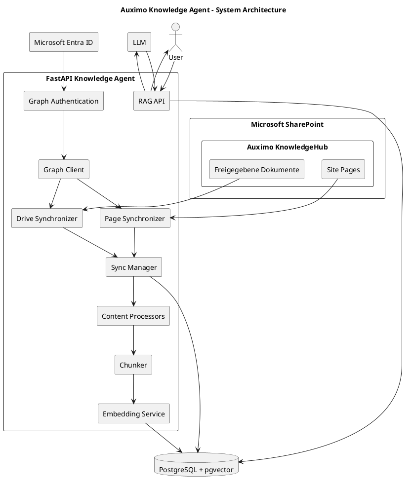
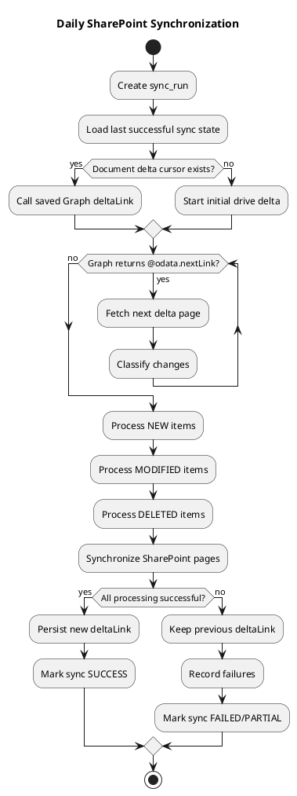
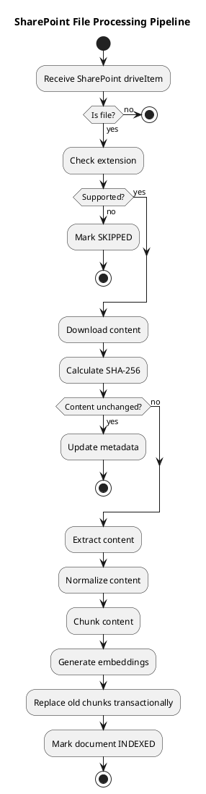
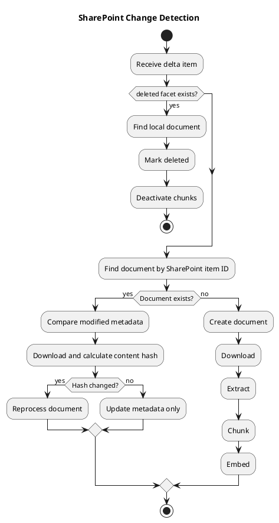

# Auximo Knowledge Agent --- Codex Implementation Specification

## 1. Purpose

Build an internal AI knowledge agent for the Auximo KnowledgeHub.

The authoritative source is the Microsoft SharePoint site:

`https://auximotechgmbh.sharepoint.com/sites/AuximoKnowledgeHub`

The system must synchronize SharePoint content into a searchable local
knowledge index, generate embeddings, and expose a RAG API that
retrieves relevant chunks and supplies them to an LLM.

### Core principle

**SharePoint is the source of truth. The vector index is a derived,
disposable representation.**

If the database/vector index is lost, a full synchronization must be
able to reconstruct it from SharePoint.

The implementation must prioritize correctness, traceability,
idempotency, safe retries, deletion handling, and source citations over
premature optimization.

------------------------------------------------------------------------

# 2. Scope

## In scope

-   Microsoft Graph app-only authentication using Microsoft Entra ID
-   One SharePoint site
-   One SharePoint document library
-   Recursive folder/file discovery
-   SharePoint Site Pages discovery
-   Initial full synchronization
-   Daily incremental synchronization
-   Detection of:
    -   new files
    -   modified files
    -   deleted files
    -   new/modified/deleted pages where supported
-   Persistent synchronization state
-   File downloading
-   File-type routing
-   Text/content extraction
-   Content normalization
-   Chunking
-   Embeddings
-   Vector search
-   RAG retrieval
-   Source metadata/citations
-   Sync logging
-   Retry/error handling
-   Manual synchronization
-   Health/status endpoints
-   Tests
-   Structured logging

## Explicitly out of scope for the first implementation

-   Real-time SharePoint webhook notifications
-   Video/MP4 ingestion
-   Editing SharePoint content
-   Writing content back to SharePoint
-   Multi-tenant SharePoint support
-   User-specific SharePoint permission filtering
-   Autonomous agent actions in SharePoint

------------------------------------------------------------------------

# 3. Known SharePoint Environment

## Site

Human-facing URL:

`https://auximotechgmbh.sharepoint.com/sites/AuximoKnowledgeHub`

Site ID:

`auximotechgmbh.sharepoint.com,4d3bde5b-d742-44b8-bf06-b205afc7dc40,1bd03151-64d7-407a-94d9-5c4f0119b36b`

Site GUID:

`4d3bde5b-d742-44b8-bf06-b205afc7dc40`

## Pages

Human-facing pages view:

`https://auximotechgmbh.sharepoint.com/sites/AuximoKnowledgeHub/SitePages/Forms/AllPages.aspx`

This is a SharePoint UI/view URL. Do not scrape this page.

Use Microsoft Graph SharePoint page APIs underneath.

## Document library

Human-facing documents view:

`https://auximotechgmbh.sharepoint.com/sites/AuximoKnowledgeHub/Freigegebene%20Dokumente/Forms/AllItems.aspx`

Library name:

`Freigegebene Dokumente`

Drive ID:

`b!W947TULXuES_BrIFr8fcQFEx0BvXZHpAlNlcTwEZs2u46mosMBgkS7v7Umy5as83`

Again, the UI URL is retained as source/reference metadata, but Graph
Drive APIs are used for synchronization.

------------------------------------------------------------------------

# 4. Supported Content

The ingestion pipeline must support:

  Extension   Source             Processing
  ----------- ------------------ ------------------------------------
  `.aspx`     SharePoint page    Graph Site Page API
  `.md`       Document library   Markdown/text
  `.pptx`     Document library   PowerPoint extraction
  `.json`     Document library   JSON parsing + text representation
  `.py`       Document library   Source-code text
  `.png`      Document library   OCR/vision extraction
  `.html`     Document library   HTML → clean text
  `.docx`     Document library   DOCX extraction
  `.xlsx`     Document library   Spreadsheet extraction
  `.pdf`      Document library   PDF extraction + OCR fallback
  `.drawio`   Document library   Draw.io XML/diagram extraction
  `.mp4`      Document library   NOT SUPPORTED

Unsupported extensions must be skipped and logged, not treated as
processing failures.

------------------------------------------------------------------------

# 5. Authentication

Use Microsoft Entra ID application authentication with OAuth 2.0 client
credentials.

The ingestion service must authenticate as the application.

Do not use delegated user authentication for SharePoint synchronization.

Environment variables:

``` env
TENANT_ID=
CLIENT_ID=
CLIENT_SECRET=

SHAREPOINT_HOST=auximotechgmbh.sharepoint.com
SHAREPOINT_SITE_PATH=/sites/AuximoKnowledgeHub

SHAREPOINT_SITE_ID=
SHAREPOINT_DRIVE_ID=

GRAPH_BASE_URL=https://graph.microsoft.com/v1.0
```

Never log:

-   client secret
-   access token
-   refresh token
-   Authorization header
-   temporary download URLs containing authorization material

Use MSAL for token acquisition.

Token endpoint authority:

`https://login.microsoftonline.com/{TENANT_ID}`

Scope:

`https://graph.microsoft.com/.default`

The application currently uses selected site access rather than
tenant-wide SharePoint access.

------------------------------------------------------------------------

# 6. Permissions

Preferred security model:

``` text
Microsoft Graph
└── Application
    └── Sites.Selected
        └── AuximoKnowledgeHub
            └── read
```

The app must not request `Sites.Read.All` unless a tested API
requirement makes the selected-site approach impossible and the security
decision is explicitly approved.

Important: granting `Sites.Selected` to the app registration does not
itself grant access to a site. An explicit site-level permission
assignment is required.

The application should remain read-only.

Microsoft documentation:

-   Selected permissions:
    https://learn.microsoft.com/en-us/graph/permissions-selected-overview
-   Permissions reference:
    https://learn.microsoft.com/en-us/graph/permissions-reference

------------------------------------------------------------------------

# 7. Important Graph API Constraint

Before finalizing the page synchronization implementation, verify the
exact permissions supported by the required Site Page endpoints.

Current Microsoft Graph documentation lists `Sites.Read.All` as the
least-privileged application permission for listing SharePoint
`sitePage` resources.

Therefore:

1.  Do not silently assume every Site Page API works with
    `Sites.Selected`.
2.  Implement a capability test.
3.  If the page endpoint returns a permission error, stop page ingestion
    and record a clear configuration error.
4.  Do not automatically escalate permissions.
5.  Document the minimum permission actually required after testing.

The document-library synchronization and page synchronization should be
separate modules so this difference does not contaminate the
architecture.

------------------------------------------------------------------------

# 8. Target Architecture

``` text
                    Microsoft SharePoint
                  Auximo KnowledgeHub
                           |
             +-------------+-------------+
             |                           |
        Site Pages                  Document Library
             |                           |
             +-------------+-------------+
                           |
                           v
                 Microsoft Graph API
                           |
                           v
                 FastAPI Sync Service
                           |
              +------------+------------+
              |                         |
        Page Synchronizer        Drive Synchronizer
              |                         |
              +------------+------------+
                           |
                           v
                   Change Detector
                           |
            +--------------+--------------+
            |              |              |
           NEW          MODIFIED       DELETED
            |              |              |
            +--------------+--------------+
                           |
                           v
                  Document State DB
                           |
                           v
                      Downloader
                           |
                           v
                  Content Extractor
                           |
                           v
                    Normalization
                           |
                           v
                       Chunker
                           |
                           v
                     Embeddings
                           |
                           v
                  PostgreSQL/pgvector
                           |
                           v
                       Retriever
                           |
                           v
                          LLM
                           |
                           v
                    RAG API Response
```

------------------------------------------------------------------------

# 9. Technology Decisions

Recommended initial stack:

-   Python 3.12+
-   FastAPI
-   Pydantic / pydantic-settings
-   MSAL
-   HTTP client: `httpx` preferred for production async code
-   PostgreSQL
-   pgvector
-   SQLAlchemy 2.x
-   Alembic
-   Background worker initially implemented as a controlled application
    job
-   APScheduler or an external scheduler for daily execution
-   pytest
-   structured logging

Do not introduce Celery/Redis/Kafka unless the actual workload requires
them.

The first version should remain operationally simple.

------------------------------------------------------------------------

# 10. Project Structure

Use:

``` text
knowledge-agent/
│
├── app/
│   ├── __init__.py
│   ├── main.py
│   ├── config.py
│   │
│   ├── auth/
│   │   ├── __init__.py
│   │   └── graph_auth.py
│   │
│   ├── sharepoint/
│   │   ├── __init__.py
│   │   ├── client.py
│   │   ├── drives.py
│   │   ├── files.py
│   │   ├── pages.py
│   │   └── delta.py
│   │
│   ├── sync/
│   │   ├── __init__.py
│   │   ├── manager.py
│   │   ├── discovery.py
│   │   ├── change_detector.py
│   │   ├── state.py
│   │   └── reconciliation.py
│   │
│   ├── processing/
│   │   ├── __init__.py
│   │   ├── router.py
│   │   ├── base.py
│   │   ├── markdown.py
│   │   ├── pdf.py
│   │   ├── docx.py
│   │   ├── pptx.py
│   │   ├── xlsx.py
│   │   ├── json_processor.py
│   │   ├── python.py
│   │   ├── html.py
│   │   ├── image.py
│   │   └── drawio.py
│   │
│   ├── chunking/
│   │   ├── __init__.py
│   │   └── chunker.py
│   │
│   ├── embeddings/
│   │   ├── __init__.py
│   │   └── embedder.py
│   │
│   ├── vectorstore/
│   │   ├── __init__.py
│   │   └── repository.py
│   │
│   ├── rag/
│   │   ├── __init__.py
│   │   ├── retriever.py
│   │   └── generator.py
│   │
│   ├── db/
│   │   ├── __init__.py
│   │   ├── database.py
│   │   ├── models.py
│   │   └── migrations/
│   │
│   └── api/
│       ├── __init__.py
│       ├── sync.py
│       ├── health.py
│       └── query.py
│
├── tests/
│   ├── unit/
│   ├── integration/
│   └── fixtures/
│
├── .env
├── .env.example
├── .gitignore
├── requirements.txt
├── alembic.ini
├── README.md
└── docker-compose.yml
```

------------------------------------------------------------------------

# 11. Configuration Requirements

`config.py` must use typed settings.

Example:

``` python
from pydantic_settings import BaseSettings, SettingsConfigDict


class Settings(BaseSettings):
    tenant_id: str
    client_id: str
    client_secret: str

    sharepoint_host: str
    sharepoint_site_path: str
    sharepoint_site_id: str
    sharepoint_drive_id: str

    graph_base_url: str = "https://graph.microsoft.com/v1.0"

    sync_interval_hours: int = 24

    model_config = SettingsConfigDict(
        env_file=".env",
        case_sensitive=False,
    )


settings = Settings()
```

Validate required configuration at startup.

------------------------------------------------------------------------

# 12. Graph Authentication Service

Create a reusable `GraphAuth` service.

Responsibilities:

-   create MSAL confidential client
-   obtain application token
-   cache token when possible
-   expose token to Graph client
-   never log secrets/tokens

Interface:

``` python
class GraphAuth:
    def get_access_token(self) -> str:
        ...
```

Do not put authentication logic into individual SharePoint services.

------------------------------------------------------------------------

# 13. Graph Client

Create one reusable Graph client.

Responsibilities:

-   add authorization headers
-   send GET requests
-   handle absolute Graph URLs
-   timeout requests
-   retry transient HTTP failures
-   handle 429 throttling
-   expose JSON responses
-   expose binary downloads
-   never log authorization data

Conceptual interface:

``` python
class GraphClient:
    async def get_json(self, endpoint: str) -> dict:
        ...

    async def get_bytes(self, endpoint: str) -> bytes:
        ...

    async def get_paged(self, endpoint: str) -> list[dict]:
        ...
```

`get_paged()` must follow `@odata.nextLink` until exhausted.

Do not assume one Graph response contains all results.

------------------------------------------------------------------------

# 14. Graph Pagination

Every list operation must support pagination.

Graph may return:

``` json
{
  "value": [],
  "@odata.nextLink": "..."
}
```

The client must continue requesting the next link.

Never manually construct the next URL if Graph provides
`@odata.nextLink`.

Use the returned URL exactly.

------------------------------------------------------------------------

# 15. Drive Discovery

The document library is represented by a Graph Drive.

Initial discovery endpoint:

``` http
GET /drives/{drive-id}
```

Root children:

``` http
GET /drives/{drive-id}/root/children
```

Folder children:

``` http
GET /drives/{drive-id}/items/{item-id}/children
```

A folder is identified by the `folder` facet.

A file is identified by the `file` facet.

Never call `/content` on a folder.

------------------------------------------------------------------------

# 16. Recursive Discovery

Implement recursive traversal for initial synchronization.

Pseudo-code:

``` python
async def walk_folder(drive_id: str, folder_id: str):
    items = await graph.get_paged(
        f"/drives/{drive_id}/items/{folder_id}/children"
    )

    for item in items:
        if "folder" in item:
            await walk_folder(drive_id, item["id"])

        elif "file" in item:
            yield item
```

The implementation must be iterative or otherwise protect against
pathological recursion depth.

Store metadata for every discovered supported file.

Do not hardcode folder IDs.

The test folder/file IDs already discovered during manual testing are
test fixtures, not production configuration.

------------------------------------------------------------------------

# 17. File Downloading

For an actual file item:

``` http
GET /drives/{drive-id}/items/{item-id}/content
```

Only download items containing a `file` facet.

The response is binary content.

Do not store the temporary `@microsoft.graph.downloadUrl` as permanent
state.

The Graph documentation states that only driveItems with the `file`
property can be downloaded.

Reference:

https://learn.microsoft.com/en-us/graph/api/driveitem-get-content?view=graph-rest-1.0

The downloader should return:

``` python
DownloadedFile(
    item_id=...,
    filename=...,
    content=...,
    content_type=...,
)
```

------------------------------------------------------------------------

# 18. Initial Synchronization

The first sync must perform a full inventory.

Flow:

``` text
START
  |
  v
Create sync_run
  |
  v
Discover document library
  |
  v
Recursively enumerate all items
  |
  v
Filter supported files
  |
  v
Upsert document metadata
  |
  v
Download/process supported content
  |
  v
Store chunks/embeddings
  |
  v
Synchronize pages
  |
  v
Persist successful synchronization state
  |
  v
Mark sync_run SUCCESS
```

The first successful full scan establishes the baseline.

------------------------------------------------------------------------

# 19. Delta Synchronization

Use Microsoft Graph DriveItem delta for document-library change
tracking.

Endpoint:

``` http
GET /drives/{drive-id}/root/delta
```

Microsoft Graph returns pages containing `@odata.nextLink` and
eventually an `@odata.deltaLink`.

Continue through every `@odata.nextLink`.

Only after all changes have been processed successfully should the new
`@odata.deltaLink` be persisted as the current synchronization cursor.

For subsequent runs:

``` http
GET {previous_delta_link}
```

Do not reconstruct or edit the delta URL.

Microsoft documentation:

https://learn.microsoft.com/en-us/graph/api/driveitem-delta?view=graph-rest-1.0

------------------------------------------------------------------------

# 20. Delta Processing

Each delta item must be classified:

### New

No matching `sharepoint_item_id` exists locally.

Action:

``` text
create document
download
extract
chunk
embed
```

### Modified

Same SharePoint item ID exists, but the item changed.

Use metadata such as:

-   `lastModifiedDateTime`
-   `eTag`
-   content hash after download

Action:

``` text
download
calculate hash
if content unchanged:
    update metadata only
else:
    remove/replace old chunks
    extract
    chunk
    embed
```

### Deleted

Delta item has the `deleted` facet.

Action:

``` text
mark document deleted
remove/deactivate its chunks
```

Microsoft specifically documents deleted items as being returned with
the `deleted` facet.

------------------------------------------------------------------------

# 21. Delta State Safety

Never do:

``` python
save_delta_link(new_link)
process_changes()
```

Correct order:

``` text
load old delta
       |
       v
fetch changes
       |
       v
process all changes
       |
       v
all successful?
   |             |
  YES           NO
   |             |
   v             v
save new       retain old
delta link     delta link
```

If a sync fails, keep the last known-good delta link.

This allows the next retry to resume from the previous consistent state.

------------------------------------------------------------------------

# 22. Delta Pagination

Delta itself can be paginated.

The algorithm must be:

``` python
url = saved_delta_link_or_initial_delta_endpoint

while url:
    response = await graph.get_json(url)

    process response["value"]

    if "@odata.nextLink" in response:
        url = response["@odata.nextLink"]
    else:
        new_delta_link = response["@odata.deltaLink"]
        break
```

Do not save the final delta link before all change processing succeeds.

------------------------------------------------------------------------

# 23. Full Reconciliation

Delta synchronization is the normal path.

Add a periodic full reconciliation mechanism.

Recommended default:

-   daily delta sync
-   weekly full reconciliation initially

The reconciliation should:

1.  enumerate current SharePoint inventory
2.  compare against local state
3.  detect anything missing from delta processing
4.  detect stale local records
5.  repair discrepancies

This is a safety mechanism, not the primary daily synchronization
mechanism.

------------------------------------------------------------------------

# 24. Document State Database

Use PostgreSQL.

Recommended `documents` table:

``` text
documents
---------
id UUID PRIMARY KEY

source_type
    file | page

sharepoint_item_id
drive_id
site_id

name
extension
mime_type

path
sharepoint_url
parent_sharepoint_item_id

created_at
modified_at
etag
size

content_hash

processing_status
processing_error
retry_count

is_deleted

last_seen_at
last_synced_at
last_processed_at

created_db_at
updated_db_at
```

Create a unique constraint on:

``` text
(source_type, sharepoint_item_id)
```

For files, the Graph drive item ID is the canonical identity.

Do not use filename as identity.

------------------------------------------------------------------------

# 25. Chunk Database

Recommended `chunks` table:

``` text
chunks
------
id UUID PRIMARY KEY

document_id UUID REFERENCES documents(id)

chunk_index
content
token_count

embedding vector(...)

metadata JSONB

created_at
updated_at
```

Every chunk must retain enough metadata to reconstruct the source.

Minimum metadata:

``` json
{
  "source_type": "file",
  "sharepoint_item_id": "...",
  "name": "Dependancies.md",
  "path": "/02_Development/...",
  "sharepoint_url": "...",
  "chunk_index": 0
}
```

------------------------------------------------------------------------

# 26. Sync Runs

Recommended `sync_runs` table:

``` text
sync_runs
---------
id UUID PRIMARY KEY

sync_type
    initial
    delta
    reconciliation
    manual

started_at
completed_at

status
    running
    success
    partial
    failed

items_detected
items_added
items_modified
items_deleted
items_skipped
items_failed

error_count

error_summary
```

Every synchronization must create a run record.

------------------------------------------------------------------------

# 27. Sync State

Recommended table:

``` text
sync_state
----------
source PRIMARY KEY

delta_link
last_successful_sync
last_attempted_sync

status
```

Possible source values:

``` text
document_library
site_pages
```

Do not store a delta cursor without knowing which source it belongs to.

------------------------------------------------------------------------

# 28. Content Hashing

For every successfully downloaded file:

``` text
SHA-256(content)
```

Store it as `content_hash`.

Purpose:

-   avoid unnecessary embedding calls
-   detect actual content changes
-   support auditing
-   improve idempotency

Example:

``` text
SharePoint says modified
        |
        v
download
        |
        v
SHA-256
        |
        +---- same ----> metadata update only
        |
        +---- different -> reprocess
```

------------------------------------------------------------------------

# 29. Processing Pipeline

Processing must be independent from synchronization.

``` text
DownloadedFile
      |
      v
Extension Router
      |
      +--> MarkdownProcessor
      +--> PdfProcessor
      +--> DocxProcessor
      +--> PptxProcessor
      +--> XlsxProcessor
      +--> JsonProcessor
      +--> PythonProcessor
      +--> HtmlProcessor
      +--> ImageProcessor
      +--> DrawioProcessor
```

Every processor should implement a common interface:

``` python
class ContentProcessor(Protocol):
    async def extract(
        self,
        file: DownloadedFile,
    ) -> ExtractedContent:
        ...
```

------------------------------------------------------------------------

# 30. Extraction Rules

## Markdown

Preserve:

-   headings
-   lists
-   code blocks
-   tables where practical

Remove irrelevant formatting noise.

## Python

Preserve code exactly where possible.

Do not blindly split code in the middle of functions.

Use syntax-aware chunking later if needed.

## JSON

Pretty-print or convert into a readable textual representation.

Avoid embedding huge unstructured minified JSON.

## HTML

Remove:

-   scripts
-   styles
-   navigation noise
-   irrelevant boilerplate

Preserve:

-   headings
-   paragraphs
-   meaningful links
-   lists
-   tables

## DOCX

Extract:

-   paragraphs
-   headings
-   tables

Preserve document structure in normalized text.

## PPTX

Extract:

-   slide title
-   slide text
-   notes if available and intentionally supported

Include slide number in metadata.

## XLSX

Extract:

-   workbook name
-   sheet name
-   meaningful cell values
-   table-like structures

Avoid producing an enormous meaningless flattened string.

## PDF

Extract text from pages.

Store page numbers.

Use OCR only where text extraction is insufficient.

## PNG

Use OCR/vision extraction.

Store image metadata.

## Draw.io

Parse the diagram XML.

Extract:

-   node labels
-   relationship information where possible
-   diagram/page names

Do not treat the raw XML as the final knowledge representation.

------------------------------------------------------------------------

# 31. SharePoint Pages

Pages are a separate source type.

Do not scrape:

`/SitePages/Forms/AllPages.aspx`

Use Graph Site Page APIs.

Current Microsoft Graph documentation:

`GET /sites/{site-id}/pages/microsoft.graph.sitePage`

Reference:

https://learn.microsoft.com/en-us/graph/api/sitepage-list?view=graph-rest-1.0

The implementation must verify actual application permissions available
to the selected-site app before enabling page ingestion.

Page state should use the page's stable Graph identity, title, web URL,
modification information, and content hash where available.

------------------------------------------------------------------------

# 32. Page Processing

Normalize a page into structured text.

Recommended representation:

``` text
TITLE: ...

DESCRIPTION: ...

SECTION:
...

TEXT:
...

WEB URL:
...
```

For page content containing web parts, preserve meaningful textual
content.

Do not embed raw Graph JSON.

Store the original SharePoint page URL as source metadata.

------------------------------------------------------------------------

# 33. Chunking

Chunking must be structure-aware.

Do not simply split every N characters.

Recommended strategy:

1.  split by document sections/headings
2.  preserve semantic units
3.  split oversized sections
4.  apply modest overlap
5.  keep source metadata on every chunk

Configuration should be environment-driven.

Example:

``` env
CHUNK_SIZE=800
CHUNK_OVERLAP=120
```

These values are starting points, not permanent truths. Benchmark
retrieval quality before finalizing.

------------------------------------------------------------------------

# 34. Chunk Identity

For deterministic behavior, generate a stable chunk identity from:

``` text
document identity
+
content hash
+
chunk index
```

Do not depend on random IDs to determine whether a chunk already exists.

When a document is reprocessed, old chunks should be removed/deactivated
before the new chunk set becomes authoritative.

Use a transaction or versioning strategy to prevent partial document
replacement.

------------------------------------------------------------------------

# 35. Embeddings

Create an abstraction:

``` python
class EmbeddingProvider(Protocol):
    async def embed(self, texts: list[str]) -> list[list[float]]:
        ...
```

Do not hardcode the embedding provider into the chunker.

The embedding model must be configurable.

Store the embedding model name/version in metadata or configuration.

If the embedding model changes, the system must support a full
re-embedding migration.

------------------------------------------------------------------------

# 36. Vector Store

Use PostgreSQL + pgvector initially.

Benefits:

-   document state and vectors in one database
-   transactional updates
-   metadata filtering
-   easier operations
-   easy backup/recovery

Vector retrieval should support:

-   semantic similarity
-   source metadata filters
-   optional keyword/full-text signals
-   top-k retrieval

Do not add a second vector database unless there is a demonstrated
scaling requirement.

------------------------------------------------------------------------

# 37. Retrieval

RAG retrieval flow:

``` text
User question
     |
     v
Query embedding
     |
     v
Vector similarity search
     |
     v
Metadata filtering
     |
     v
Top candidate chunks
     |
     v
Optional reranking
     |
     v
Final context
     |
     v
LLM
```

Retrieved chunks must retain:

-   source name
-   source URL
-   path
-   relevant section/page/slide if applicable

------------------------------------------------------------------------

# 38. LLM Prompting

The RAG generator must be instructed:

-   answer from retrieved context
-   do not invent facts
-   distinguish missing information
-   cite source documents/pages
-   avoid claiming SharePoint information that was not retrieved
-   mention uncertainty when context is insufficient

The prompt must not imply that the vector database is authoritative.

The authoritative source is SharePoint.

------------------------------------------------------------------------

# 39. Source Citations

Every answer generated from retrieved content should be able to expose
source information.

Example:

``` text
According to the deployment documentation, ...

Sources:
- Deployment Guide — SharePoint
- Cloud Flow Library — SharePoint
```

The system should store the actual SharePoint `webUrl` for every source.

For files:

``` text
sharepoint_url = driveItem.webUrl
```

For pages:

``` text
sharepoint_url = page.webUrl
```

------------------------------------------------------------------------

# 40. API Endpoints

Initial FastAPI API:

``` text
GET  /health
GET  /health/graph

POST /sync
GET  /sync/{sync_id}
GET  /sync/latest

POST /sync/reconcile

GET  /documents
GET  /documents/{id}

POST /query
```

Example:

``` http
POST /sync
```

Response:

``` json
{
  "sync_id": "uuid",
  "status": "started"
}
```

Do not make the HTTP request wait for a large synchronization.

------------------------------------------------------------------------

# 41. Sync Execution

The sync endpoint should create a job and return immediately.

Conceptually:

``` text
POST /sync
     |
     v
create sync_run
     |
     v
queue/background execution
     |
     v
return sync_id
```

The status endpoint provides progress.

------------------------------------------------------------------------

# 42. Idempotency

Running the same synchronization twice must not create duplicate
documents or chunks.

Required safeguards:

-   unique SharePoint item identity
-   deterministic content hash
-   deterministic chunk identity
-   transactional replacement
-   idempotent upserts

Example:

``` text
same SharePoint item
+
same content hash
=
no re-embedding
```

------------------------------------------------------------------------

# 43. Error Handling

Classify errors.

### Transient

Examples:

-   HTTP 429
-   HTTP 502
-   HTTP 503
-   connection timeout

Action:

-   exponential backoff
-   retry with limit

### Permanent

Examples:

-   unsupported format
-   invalid file
-   permission denied
-   malformed document

Action:

-   record error
-   mark item appropriately
-   continue processing other items

### Configuration

Examples:

-   missing client secret
-   invalid site ID
-   insufficient Graph permissions

Action:

-   fail fast
-   clearly report configuration problem

------------------------------------------------------------------------

# 44. Rate Limiting

Microsoft Graph can throttle clients.

Handle HTTP 429.

Respect:

-   `Retry-After`

Use exponential backoff for transient errors.

Do not aggressively parallelize hundreds of Graph requests.

Start conservatively and measure.

------------------------------------------------------------------------

# 45. Concurrency

Initial implementation should use bounded concurrency.

Do not:

``` python
asyncio.gather(*all_files)
```

for thousands of files without limits.

Use a bounded semaphore or worker pool.

Separate limits for:

-   Graph downloads
-   extraction
-   embeddings

------------------------------------------------------------------------

# 46. Logging

Use structured logs.

Every sync should include:

``` text
sync_id
source
item_id
operation
status
duration
error
```

Example:

``` text
sync_id=abc
item_id=xyz
operation=download
status=success
duration_ms=420
```

Never log secrets or tokens.

------------------------------------------------------------------------

# 47. Observability

At minimum expose:

``` text
last successful sync
current sync status
number of documents
number of chunks
failed documents
last error
```

Later add metrics for:

-   sync duration
-   Graph API calls
-   throttling
-   extraction failures
-   embedding latency
-   retrieval latency

------------------------------------------------------------------------

# 48. Testing Strategy

## Unit tests

Test:

-   configuration
-   token acquisition mocking
-   Graph pagination
-   delta processing
-   item classification
-   hash comparison
-   chunking
-   processor routing
-   deletion handling
-   retry behavior

## Integration tests

Use a controlled test SharePoint folder and/or mocked Graph responses.

Test:

``` text
new file
modified file
deleted file
nested folder
unsupported file
large file
Graph pagination
Graph throttling
delta pagination
```

## RAG tests

Create a small known corpus and verify:

-   relevant chunks are retrieved
-   irrelevant chunks are not over-selected
-   sources are returned
-   answers don't cite nonexistent sources

------------------------------------------------------------------------

# 49. Initial Acceptance Tests

The implementation is not complete until these scenarios pass.

### Test 1 --- New file

Add:

`test.md`

Expected:

``` text
new document
download
extract
chunk
embed
```

### Test 2 --- Modified file

Edit:

`test.md`

Expected:

``` text
same SharePoint item ID
new content hash
old chunks replaced
new chunks inserted
```

### Test 3 --- Deleted file

Delete:

`test.md`

Expected:

``` text
deleted facet detected
document marked deleted
chunks removed/deactivated
```

### Test 4 --- Nested folder

Create:

``` text
A/
  B/
    C/
      test.md
```

Expected:

``` text
test.md discovered
```

### Test 5 --- Unsupported file

Add:

`video.mp4`

Expected:

``` text
skipped
not an error
```

### Test 6 --- Pagination

Mock multiple Graph pages.

Expected:

``` text
all items discovered
```

### Test 7 --- Failed synchronization

Force a processing failure.

Expected:

``` text
old delta link retained
sync marked failed/partial
failed item recorded
next run can retry
```

### Test 8 --- Recovery

Fix the failure and rerun.

Expected:

``` text
item processed
delta state advances
sync succeeds
```

------------------------------------------------------------------------

# 50. Security Requirements

Never commit `.env`.

`.gitignore`:

``` text
.env
.venv/
venv/
__pycache__/
*.pyc
.pytest_cache/
```

Use `.env.example` with empty placeholders.

Never log:

``` text
CLIENT_SECRET
ACCESS_TOKEN
Authorization
downloadUrl
```

Temporary Graph download URLs can contain authorization information.

Do not expose raw Graph error responses containing sensitive details
through public APIs.

------------------------------------------------------------------------

# 51. SharePoint Permission Model

All employees currently have access to the KnowledgeHub.

The ingestion service should use application-level access to the site
rather than impersonating an employee.

The RAG layer should not invent per-user access restrictions that do not
exist in the initial requirements.

If SharePoint permissions become granular in the future, the
architecture must be extendable to permission-aware retrieval.

------------------------------------------------------------------------

# 52. Source-of-Truth Rule

Never allow the vector DB to become the canonical inventory.

Canonical:

``` text
SharePoint
```

Derived:

``` text
PostgreSQL document state
PostgreSQL chunks
pgvector embeddings
```

If discrepancies occur:

``` text
SharePoint wins
```

------------------------------------------------------------------------

# 53. Recovery / Rebuild

The system must support:

``` text
POST /sync?mode=full
```

or an equivalent explicit full synchronization command.

A full rebuild must:

1.  enumerate SharePoint
2.  rebuild document state
3.  reprocess supported content
4.  regenerate embeddings
5.  remove stale local records

A rebuild should be safe to run without manually editing database rows.

------------------------------------------------------------------------

# 54. No Hardcoded Folder Tree

Do not code:

``` python
folders = [
    "01_Operations",
    "02_Development",
]
```

The crawler must discover the tree from Graph.

Known IDs are configuration only where stable resource IDs are
intentionally configured, such as the selected site and drive.

------------------------------------------------------------------------

# 55. Source Metadata Requirements

For every indexed document/chunk, preserve:

``` text
source_type
sharepoint_item_id
site_id
drive_id
name
extension
mime_type
path
sharepoint_url
modified_at
etag
content_hash
```

For structured formats additionally preserve:

``` text
page_number
slide_number
sheet_name
heading
section
```

when applicable.

------------------------------------------------------------------------

# 56. Recommended Processing State Machine

Document states:

``` text
DISCOVERED
    |
    v
PENDING
    |
    v
DOWNLOADING
    |
    v
EXTRACTING
    |
    v
CHUNKING
    |
    v
EMBEDDING
    |
    v
INDEXED
```

Failure states:

``` text
DOWNLOAD_FAILED
EXTRACTION_FAILED
CHUNKING_FAILED
EMBEDDING_FAILED
```

Retryable failures should return to `PENDING` after backoff.

------------------------------------------------------------------------

# 57. Transactional Document Replacement

For a modified document:

``` text
BEGIN TRANSACTION

mark document processing

delete/deactivate old chunks

insert new chunks

insert embeddings

mark document INDEXED

COMMIT
```

If processing fails:

``` text
ROLLBACK
```

Do not leave the document with half of its old chunks deleted and no new
chunks.

For very large files, use a staging/version approach if a single DB
transaction becomes impractical.

------------------------------------------------------------------------

# 58. Daily Scheduler

Target:

``` text
once every 24 hours
```

Recommended initial schedule:

``` text
02:00 local/server time
```

Make the schedule configurable.

The scheduler must not launch a second synchronization if another sync
is already running.

Use a distributed/database lock if multiple application instances can
exist.

------------------------------------------------------------------------

# 59. Manual Development Workflow

During development:

``` text
POST /sync
```

must be available.

Do not require waiting for the daily scheduler to test changes.

Also support:

``` text
POST /sync/reconcile
```

for manual reconciliation.

------------------------------------------------------------------------

# 60. Implementation Order

Codex must implement in this order.

## Phase 1 --- Foundation

1.  Project structure
2.  Settings
3.  MSAL authentication
4.  Graph client
5.  Graph pagination
6.  Health endpoints
7.  Graph/site/drive connectivity tests

## Phase 2 --- SharePoint inventory

1.  Drive discovery
2.  Recursive folder traversal
3.  File metadata extraction
4.  Supported-extension filtering
5.  Persistent document state
6.  Initial full synchronization

## Phase 3 --- Incremental sync

1.  Delta API
2.  Delta pagination
3.  Delta cursor persistence
4.  New item handling
5.  Modified item handling
6.  Deleted item handling
7.  Retry/recovery
8.  Full reconciliation

## Phase 4 --- SharePoint pages

1.  Graph page capability test
2.  Page listing
3.  Page content extraction
4.  Page state tracking
5.  Page change detection
6.  Page processing

## Phase 5 --- Content extraction

Implement each processor independently.

## Phase 6 --- Chunking

Implement structure-aware chunking.

## Phase 7 --- Embeddings

Add provider abstraction and batch processing.

## Phase 8 --- pgvector

Add vector persistence and similarity search.

## Phase 9 --- RAG

Add retrieval, source metadata, prompting and answer generation.

## Phase 10 --- Production hardening

Add:

-   metrics
-   retries
-   locks
-   monitoring
-   reconciliation
-   documentation
-   deployment
-   backups
-   security review

------------------------------------------------------------------------

# 61. Codex Rules

Codex must follow these rules throughout implementation.

### Rule 1

Do not rewrite working components unnecessarily.

### Rule 2

Do not hardcode the SharePoint folder tree.

### Rule 3

Do not use filenames as document identity.

### Rule 4

Do not scrape SharePoint HTML pages when a Graph API exists.

### Rule 5

Do not store access tokens or temporary download URLs.

### Rule 6

Do not automatically broaden permissions.

### Rule 7

Do not silently ignore synchronization errors.

### Rule 8

Do not advance a delta cursor after a failed synchronization.

### Rule 9

Do not duplicate chunks when a sync is rerun.

### Rule 10

Do not couple Graph synchronization logic to document extraction logic.

### Rule 11

Do not couple document extraction logic to the embedding provider.

### Rule 12

Every important behavior must have a test.

### Rule 13

Use async I/O for Graph and external API calls where practical.

### Rule 14

Use bounded concurrency.

### Rule 15

Prefer official Microsoft Graph v1.0 APIs for production.

------------------------------------------------------------------------

# 62. Graph API References

Microsoft Graph DriveItem delta:

https://learn.microsoft.com/en-us/graph/api/driveitem-delta?view=graph-rest-1.0

Microsoft Graph driveItem content:

https://learn.microsoft.com/en-us/graph/api/driveitem-get-content?view=graph-rest-1.0

Microsoft Graph driveItem:

https://learn.microsoft.com/en-us/graph/api/driveitem-get?view=graph-rest-1.0

Microsoft Graph SharePoint site pages:

https://learn.microsoft.com/en-us/graph/api/sitepage-list?view=graph-rest-1.0

Microsoft Graph selected permissions:

https://learn.microsoft.com/en-us/graph/permissions-selected-overview

Microsoft Graph permissions reference:

https://learn.microsoft.com/en-us/graph/permissions-reference

------------------------------------------------------------------------

# 63. PlantUML --- System Architecture



------------------------------------------------------------------------

# 64. PlantUML --- Daily Synchronization



------------------------------------------------------------------------

# 65. PlantUML --- File Processing



------------------------------------------------------------------------

# 66. PlantUML --- Change Detection



------------------------------------------------------------------------

# 67. Definition of Done

The first complete version is considered production-ready only when:

-   [ ] App-only Graph authentication works
-   [ ] Site access is restricted appropriately
-   [ ] Drive is discovered
-   [ ] Recursive discovery works
-   [ ] Graph pagination works
-   [ ] Initial inventory is persisted
-   [ ] New files are detected
-   [ ] Modified files are detected
-   [ ] Deleted files are detected
-   [ ] Delta links are persisted safely
-   [ ] Failed syncs do not corrupt delta state
-   [ ] Full reconciliation works
-   [ ] SharePoint pages are supported or a documented permission/API
    limitation exists
-   [ ] All required file processors exist
-   [ ] Unsupported files are skipped
-   [ ] Content hashes are stored
-   [ ] Chunking is deterministic
-   [ ] Embeddings are generated
-   [ ] pgvector search works
-   [ ] RAG retrieval works
-   [ ] Source URLs are returned
-   [ ] Duplicate chunks are prevented
-   [ ] Retry behavior works
-   [ ] Graph throttling is handled
-   [ ] Structured logging exists
-   [ ] Sync status is observable
-   [ ] Automated tests pass
-   [ ] Full rebuild is possible
-   [ ] Secrets are never logged or committed

------------------------------------------------------------------------

# 68. Immediate Codex Task

Do NOT implement the entire system in one pass.

First implement only:

1.  project structure
2.  configuration
3.  MSAL Graph authentication
4.  reusable Graph client
5.  Graph pagination
6.  SharePoint site health check
7.  SharePoint drive health check
8.  recursive drive discovery
9.  unit tests for pagination and discovery
10. clean README explaining how to run it

Then stop and report:

-   files created
-   tests created
-   commands to run
-   test results
-   any Graph permission limitations
-   any assumptions made

Do not implement embeddings, chunking, RAG, or LLM integration until the
synchronization foundation has been tested.

------------------------------------------------------------------------

# 69. Development Verification

The first verification should prove:

``` text
Python application
       |
       v
Entra application authentication
       |
       v
Microsoft Graph
       |
       v
Auximo KnowledgeHub
       |
       v
Freigegebene Dokumente
       |
       v
recursive discovery
       |
       v
all pages of Graph pagination handled
```

A successful result should include counts such as:

``` text
Site: Auximo KnowledgeHub
Drive: Freigegebene Dokumente

Folders discovered: N
Files discovered: N
Supported files: N
Unsupported files: N

Pagination pages: N
```

Do not print secrets or access tokens.

------------------------------------------------------------------------

# 70. Final Architecture Principle

The system should always be understandable as:

``` text
SHAREPOINT
    ↓
SYNCHRONIZATION
    ↓
DOCUMENT STATE
    ↓
CONTENT PROCESSING
    ↓
CHUNKS
    ↓
EMBEDDINGS
    ↓
VECTOR SEARCH
    ↓
RAG
    ↓
LLM
```

Each layer must have a clear responsibility and a testable interface.

The implementation should be incremental, observable, recoverable, and
safe to rebuild.
